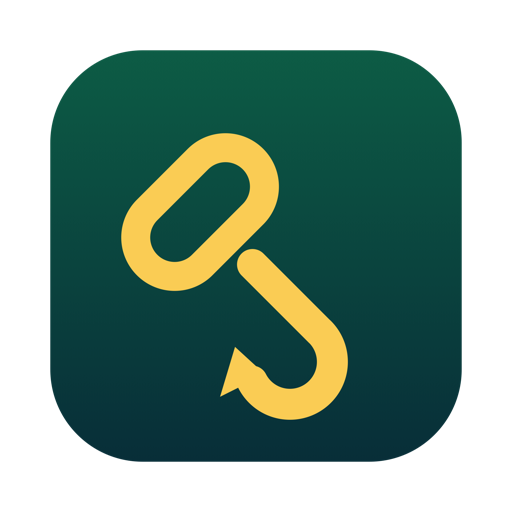

<p align="center"></p>

<h1 align="center">HookLink</h1>

<p align="center"><b>The Legend of Zelda: Ocarina of Time (Nintendo Switch 2 Edition) on your iPhone, natively, built on your Mac from your own copy of the game.</b></p>

<p align="center">
<a href="#project-status">Status</a> · <a href="#how-to-build">How to build</a> · <a href="#installing-and-copying-the-game">Install</a> · <a href="#what-hookLink-tunes-for-the-iphone">What it tunes</a> · <a href="#if-something-goes-wrong">Problems</a> · <a href="#want-to-help">Help</a> · <a href="#credits">Credits</a> · <a href="#license">License</a>
</p>

HookLink is a Mac app that turns your own dump of Ocarina of Time into an iPhone app. It runs [nxnative](https://github.com/seedds/nxnative), which translates the game's code and its graphics to Apple's Metal, with changes made and tested for this one game on the iPhone: faster pipeline loading, memory fixes, real-time game speed below 60 fps, and a resolution tuned for the phone. No emulator is involved.

> [!IMPORTANT]
> This repository does not contain the game, keys or a built app, and it does not explain how to get them. You need your own copy. Everything HookLink makes (the IPA, the game files on your phone, the shader caches and your saves) comes from your game and stays on your Mac and your phone. **Never share those files.**

## Project status

**Experimental.** Tested on one iPhone (iPhone 18 Pro Max, iOS 27.2), built on one Mac.

| What | Status |
|---|---|
| Kokiri Forest, Hyrule Field, Castle Town | ✅ Plays |
| Sound, touch controls, controllers, saves | ✅ Works |
| 60 fps | ⚠️ Most areas; Hyrule Field dips in the 40s–50s when the phone is warm |
| Stutter the first time you enter an area | ⚠️ Happens once; the next start prepares that area |
| First start after installing | ⚠️ Long "Preparing shaders" screen, a few minutes, once |
| iPhone 17 family (A19) | ❓ Should work, not tested yet |
| Older iPhones | ❌ Not supported (memory and graphics) |

## How to build

### With the HookLink app (the easy way)

1. Download **HookLink.zip** from the [Releases](../../releases) page and unzip it.
2. Right-click **HookLink.app** → **Open** (the first time only; it isn't from the App Store).
3. Follow the steps in the window:
   1. **Check your Mac**: HookLink finds what's missing and installs most of it for you.
   2. **Choose your game**: drop your `.nup` file in.
   3. **Choose your iPhone** model.
   4. **Build**: a few hours the first time. You can keep using your Mac.
   5. **Install** the IPA with your sideloading tool.
   6. **Copy game files**: plug in your iPhone and click one button.
   7. **Play.**

### What you need

- A Mac with Apple silicon, macOS 26.6 or later.
- [Xcode 27.2](https://developer.apple.com/download/all/?q=Xcode%2027.2), opened once, with the iOS platform (Xcode → Settings → Components).
- [Homebrew](https://brew.sh).
- About **80 GB free** while building.
- Your game: program `0400486024DEC000`, update `v131072`, as a `.nup`. Other versions don't work.
- An iPhone 18 Pro / Pro Max (tested) or an iPhone 17 model (untested), with **Developer Mode** on, and a cable.
- A sideloading tool such as iLoader, Sideloadly or AltStore.

### From the command line

HookLink runs nxnative's packing script with its own settings. With nxnative (HookLink's branch) checked out:

```bash
DM_ENTITLEMENTS="$PWD/../HookLink/Resources/presets/entitlements.plist" \
python3 -I scripts/build_ipa_from_nsp.py "/path/to/your-game.nup" \
  --platform ios --romfs separate --allow-damaged --gpu g19p \
  --env-file ../HookLink/Resources/presets/iphone.env \
  -o ~/HookLink/HookLink-OcarinaOfTime.ipa
```

Use `--gpu g18p` for an iPhone 17 model.

## Installing and copying the game

The IPA holds the app, its shaders and its GPU pipeline archive (about 6 GB). The game's own files (about 24 GB) are copied to the phone separately, once:

1. Install the IPA with your sideloading tool. Turn on **Increased Memory Limit** if it offers it.
2. Don't open the game yet.
3. In HookLink, **Copy game files**: plug in your iPhone, unlock it, tap **Trust**, then click the button. HookLink copies the game files and the iPhone resolution file made from your game, then checks them.
4. Open the game.

Updating to a newer HookLink build? Install the new IPA over the old one. Your saves and game files stay; you don't need to copy them again.

## What HookLink tunes for the iPhone

- **Pipelines:** a draw waiting for its pipeline no longer repeats failed archive searches every frame. Each pipeline the game asks for is listed for the next start, which builds them all behind the loading screen.
- **Memory:** render targets share one placement heap (3 GB in 0.7 GB), and textures of scenes you've left are retired when memory runs short (fixes the freeze after the talk with Saria).
- **Game speed:** the game moves at real speed even when a frame runs long, without dropping to 30 fps.
- **Resolution:** the handheld dynamic resolution ranges from 1080×608 down to 640×360 on the phone, made from your own game files.
- **Settings:** thread priorities, no 30 fps hold, no 30 fps thermal cap.

## If something goes wrong

| Problem | What to do |
|---|---|
| HookLink says the game isn't supported | Check it's the Switch 2 Edition with update v131072, as a `.nup` |
| The build stops | Click **Show details** and look at the last lines. Free disk space and Xcode 27.2 are the usual causes |
| "No iPhone found" | Use a cable, unlock the phone, tap Trust, turn on Developer Mode |
| "The game is not installed on this iPhone" | Install the IPA first, then click **Find my iPhone** again |
| The game closes at start | Copy the game files again from HookLink; make sure Increased Memory Limit is on |
| Stutter the first time somewhere | Normal: the next start prepares that area |

Still stuck? [Open an issue](../../issues) with your iPhone model, iOS version, where you were in the game and what happened. A screenshot or video helps. **Never attach game files.**

## Want to help?

- **Test on another iPhone**, especially an iPhone 17 model, and report how it runs.
- **Play further** than anyone has, and report what breaks.
- **Send a fix**: see [CONTRIBUTING.md](CONTRIBUTING.md).

## Credits

- **[nxnative](https://github.com/seedds/nxnative)** by seedds and its contributors: the engine HookLink runs, which translates the game to native code and Metal.
- **gunvalk**: found that the game's frame step ignores the frame's time (zortos293/Lichii PR #216), the basis of the real-speed fix.
- **[HookShot](https://github.com/NotRexed/Hookshot)** by NotRexed: inspired HookLink's name.

## License

HookLink is free software under the [MIT License](LICENSE). It builds on nxnative, also MIT; its notice is kept in [NOTICE.md](NOTICE.md).

HookLink is an unofficial fan project, not affiliated with or endorsed by Nintendo. The Legend of Zelda and Ocarina of Time are trademarks of Nintendo.
